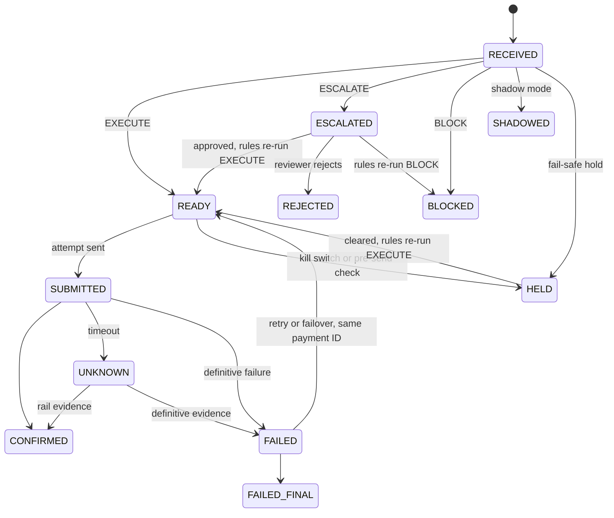

| State | Means |
|---|---|
| `RECEIVED` | Created; the decision is being made |
| `SHADOWED` | Shadow mode: decided and recorded, never sent. Final |
| `ESCALATED` | Waiting for a person (an exception case is open) |
| `HELD` | Stopped before sending: the kill switch, a failed pre-send check or the fail-safe |
| `READY` | Cleared to send. In assist mode it waits for a person to click Send |
| `SUBMITTED` | An attempt is on a rail |
| `UNKNOWN` | The rail did not answer. See below |
| `CONFIRMED` | The rail confirmed it. Final |
| `FAILED` | The attempt failed definitively; a retry or failover may follow under the same ID |
| `FAILED_FINAL`, `BLOCKED`, `REJECTED`, `CANCELLED` | Final |

## UNKNOWN is not FAILED

When a rail times out or the connection drops, nobody knows whether the money moved. Marking it FAILED and
sending again could pay twice. So DekernAI marks it **UNKNOWN** and:

- sends nothing new while any attempt is UNKNOWN;
- polls the rail for evidence (on a chain, the transaction receipt; on a bank rail, the status by idempotency key);
- moves it to CONFIRMED or FAILED only on definitive evidence;
- after 15 minutes without an answer, opens an `UNKNOWN_STUCK` case for your payments lead.

Treat UNKNOWN in your own systems the same way: keep the user's balance reserved and wait for the
`payment_intent.confirmed` or `payment_intent.failed` webhook.

## Final states never change

CONFIRMED, BLOCKED, REJECTED, CANCELLED, FAILED_FINAL and SHADOWED are final, enforced by the database. A blocked
payment is never approved, retried, re-routed or resubmitted; a new intent to the same payee or address within 24
hours (by default) is escalated with `RESUBMISSION_AFTER_BLOCK`.
