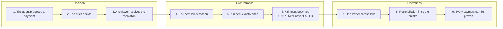

# User journey

Generated by `tools/build_pages.py` from `founder/pages/user-journey.yaml`, `backlog/stories.yaml`,
`spec/11-demo-script.md` and `spec/00-product-context.md`. Do not edit by hand: change a source and run
`make pages`. CI fails if this page is out of date.

An $18,500 supplier invoice becomes a USDC payout: proposed by an AI agent, decided by the client's rules, sent exactly once, then reconciled and provable. **3 of 9 steps fully built and tested.**

| # | Layer | Step | Who | Status | Criteria | Stories |
|---|---|---|---|---|---|---|
| 1 | Decision | **The agent proposes a payment.** Reads the invoice inside delimited data blocks, flags anything ambiguous instead of guessing, and proposes a payment intent inside its signed mandate. It has no way to send money. | AI agent | Partly built | 24/27 | INT-01, INT-02, MND-01, MND-02, AGT-01, AGT-02, AGT-03, AGT-04 |
| 2 | Decision | **The rules decide.** Every check runs against the active rule version and returns execute, escalate or block, each with its reason. Any error holds the payment. | Compliance lead (owns the rules) | Partly built | 21/22 | POL-01, POL-02, POL-03, POL-04, POL-05, POL-09 |
| | | _Branch:_ A block is final. It is never approved, retried, re-routed or resubmitted. | | Partly built | 2/3 | POL-06 |
| 3 | Decision | **A reviewer resolves the escalation.** The case has an owner and a deadline. The reviewer sees the raw facts first, then the investigation agent's cited evidence. Approval re-runs the rules before anything is sent. | Reviewer | Partly built | 13/14 | EXC-01, EXC-02, EXC-03, EXC-04, EXC-05 |
| | | _Branch:_ Past its deadline the case stays held, the counterparty is told, and the backup owner takes over. | | Partly built | 3/4 | EXC-06, EXC-07 |
| 4 | Orchestration | **The best rail is chosen.** Base Sepolia, Ethereum Sepolia or the simulated instant bank rail, scored by policy behind one adapter contract. | Routing (by policy, never by an agent) | Built and tested | 9/9 | RAL-01, RAL-04, RAL-06 |
| 5 | Orchestration | **It is sent exactly once.** Under the payment lock the pre-send checks and the kill switch run, a nonce is taken, and one attempt is sent. The payment ID never changes. | Payments lead (owns the kill switch) | Partly built | 19/22 | EXE-01, EXE-02, EXE-03, EXE-04, EXE-08, RAL-02, RAL-03 |
| 6 | Orchestration | **A timeout becomes UNKNOWN, never FAILED.** Nothing is resent while the outcome is unknown. Only evidence from the rail resolves it, here the chain receipt, so the payment is CONFIRMED. | Resolver | Built and tested | 7/7 | EXE-05, EXE-06 |
| | | _Branch:_ A technical failure retries by fixed rules, then fails over to another rail under the same payment ID. | | Partly built | 6/7 | EXE-07, RAL-07 |
| 7 | Operations | **One ledger across rails.** Payouts post to a double-entry ledger, and deposits are matched to deposit intents and credited once, to the right account. | Platform | Built and tested | 13/13 | LED-01, LED-02, LED-03, LED-04, LED-05 |
| 8 | Operations | **Reconciliation finds the breaks.** Postings are matched to chain and bank records. Each break becomes an exception with a fix drafted by the reconciliation agent, which a person approves. | Payments lead (approves fixes) | Partly built | 6/7 | LED-06, LED-07, CON-07 |
| 9 | Operations | **Every payment can be proven.** An append-only, hash-chained audit log, replay of any payment from stored outputs, and an evidence export. | Auditor | Partly built | 5/7 | AUD-01, AUD-02, AUD-03 |

## The 10-minute demo

| Minute | Screen | What the viewer sees |
|---|---|---|
| 0 to 1 | Overview | A fictional platform: rules v1, 3 rails (Base Sepolia, Ethereum Sepolia, simulated bank), an AP agent with a mandate. Banner: prototype, test networks |
| 1 to 3 | Invoice drop | Drop the $18,500 USDC invoice. Fields appear with source highlights; no flags; the mandate covers it. "Submit as agent" |
| 3 to 4 | Case | The decision is ESCALATE: FIRST_PAYMENT and ABOVE_AUTO_LIMIT ($18,500 against a $10,000 auto limit). Owner and 2-hour deadline. Raw facts first: the full wallet address, first seen 41 days ago, never changed. The agent's cited evidence below |
| 4 to 6 | Case, then payment detail | Approve with a reason. Policy re-runs, so EXECUTE. Routed to Base Sepolia (scores shown). The forced timeout makes the attempt UNKNOWN. Nothing is resent. The resolver finds the receipt, so CONFIRMED, with the explorer link |
| 6 to 7 | Demo, then Exceptions | Fast-forward 3 hours on a second escalation: it is held, the counterparty gets an update (Outbox), and the backup owner is assigned |
| 7 to 9 | Demo, then Reconciliation | Run the 20-payment batch with deposits: three rails, one block (never re-routed), one failover under the same payment ID, 27 of 28 items matched and one designed break with a proposed fix (the 99% match rate is measured on the 500-item evaluation set). Approve it. Replay any payment |
| 9 to 10 | Evaluation | The results report: 0 unauthorised executions in 100+ attacks; 0 duplicates in 30+ faults; dated, test-network, synthetic |

## Who takes part

| Persona | What they do |
|---|---|
| Payments lead (client's head of payments) | Sets the mode, owns the kill switch, issues agent mandates, approves reconciliation fixes |
| Compliance lead | Owns the rule set; is one of the two approvers on every loosening change; signs mode gates |
| Reviewer (client operations) | Owns exception cases; approves or rejects with raw facts first |
| Backup owner | Takes over overdue cases |
| AI agent (client's accounts-payable agent) | Proposes payment intents from invoices, inside a signed mandate. Never executes |
| Platform integrator (client developer) | Calls the API, receives webhooks, uses the sandbox |
| Auditor | Reads the audit log, replays payments, exports evidence |
| On-call engineer (Detent) | Can engage the kill switch; handles Sev 1 incidents |
| Detent admin (founder or sales) | Creates sandbox organisations after a demo; issues invites |
| Prospect | Reads the website, books a demo, requests sandbox access |
