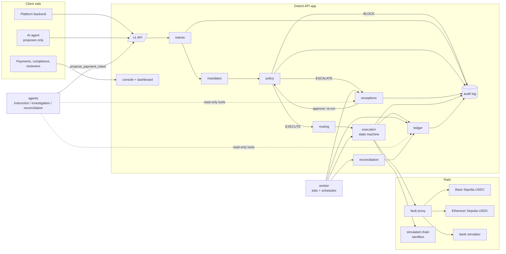
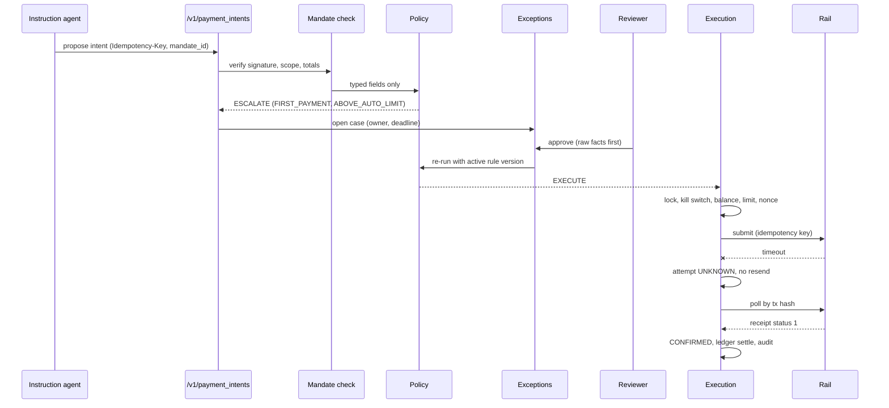

# 01 · Architecture

**Product:** agentic payment controls in three layers: decision, orchestration and operations (see `CLAUDE.md`). **This spec covers:** all three layers and how they connect.

**The three layers in code:** Decision = `intents`, `mandates`, `policy`. Orchestration = `routing`, `execution`, `rails`. Operations = `exceptions`, `ledger`, `reconciliation`, `audit`. The `agents` package serves all three through read-only tools, plus `propose_payment_intent`.

## Components



**Order of operations:** mandate check, then policy, then (on EXECUTE) routing, then pre-send checks under the lock, then send. A BLOCK never reaches routing.

## Processes

| Process | Runs | Notes |
|---|---|---|
| `api` | FastAPI: `/v1`, console, dashboard, admin | Stateless; behind TLS |
| `worker` | Job loop: UNKNOWN resolver, deadline sweeper, deposit watchers, reconciliation, investigation agent, webhook delivery, invariant monitor | One instance in the MVP; jobs idempotent, claimed with SKIP LOCKED |
| `banksim` | Simulated instant bank rail | Its own small database schema; never shares tables with `api` |
| `faultproxy` | JSON-RPC and HTTP proxy that injects faults | In the path for every rail call; pass-through unless a scenario is set |
| Postgres | One database, schemas `detent` and `banksim` | Neon, EU region, in production |

## Module boundaries

```
domain      <- everything (pure, no I/O)
policy      <- intents, mandates, exceptions, execution (re-check)
execution   <- routing, rails, ledger, audit       (never imports agents)
agents      <- read-only repositories + LLMClient   (never imports execution, rails, exceptions.approve)
api/console <- services only (never repositories directly)
```

An import-linter contract in CI enforces these arrows (AGT-03).

## The main flow (agent-proposed payout)



## Production custody boundary (not built in the MVP)

In production, transaction signing and nonce assignment happen in the client's custody or wallet provider. Detent passes the payment ID and idempotency key and keeps:

- the state lock
- the UNKNOWN logic
- the kill switch
- a second check on pre-funded limits

In the prototype, `rails/evm.py` signs with test keys from settings. Keep signing behind a `Signer` interface so that a custody-provider signer can replace it.

## Fail-safe

Each platform setting `fail_safe` is either `hold` or `manual_queue`. Any dependency failure in a decision path (database, screening, policy load, model) yields ESCALATE with `SYSTEM_UNAVAILABLE` and follows that setting. With `hold`, the payment moves RECEIVED → HELD; with `manual_queue`, RECEIVED → ESCALATED (D-09). No path executes unchecked.

## Performance targets (Estimate)

- **Rules-only decision:** p95 under 50 ms locally; under 5 s in production.
- **Agent investigation:** under 60 s; it runs asynchronously in the worker.
- **Kill switch:** takes effect before the next send (checked inside the lock).
