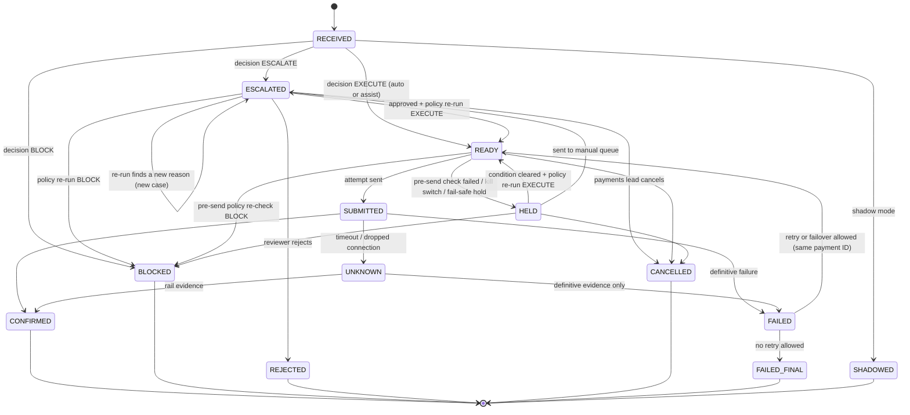

# 02 · Domain model

**Product:** agentic payment controls in three layers: decision, orchestration and operations (see `CLAUDE.md`). **This spec covers:** the data behind all three layers. The payment state machine is the core of the **orchestration** layer.

## Conventions

- **IDs:** prefixed UUIDv7 strings: `org_`, `usr_`, `key_`, `cpt_` (counterparty), `dst_` (destination), `mnd_`, `pol_`, `pay_`, `dec_`, `att_`, `exc_`, `dep_`, `inb_` (inbound transfer), `jrn_`, `rec_`, `brk_`, `agc_` (agent call), `evt_`, `inc_`.
- **Money:** `amount_minor BIGINT` plus `currency CHAR(4)` (`USDC` has 6 decimals; `GBP` and `EUR` have 2). There is a `Money` value type in `domain/money.py`. Arithmetic across currencies is an error.
- **Time:** `timestamptz` in UTC, always from `Clock`.
- **Tenancy:** every table has `org_id NOT NULL`. Repositories require it.

## Payment state machine



- **Terminal states:** CONFIRMED, BLOCKED, REJECTED, CANCELLED, FAILED_FINAL, SHADOWED.
- **Overdue escalations:** the payment stays ESCALATED and the case becomes HELD_OVERDUE. There is no ESCALATED to READY path without an approval.
- **Assist mode:** READY payments have `awaiting_send_click = true` and are not picked up by the sender until a user clicks Send.
- **The table is code.** `domain/states.py` holds `ALLOWED: dict[Status, set[Status]]`. A database trigger mirrors it for terminal states: any UPDATE of `status` on a row whose old status is terminal raises an error.

## Attempt states

```
CREATED -> SUBMITTED -> CONFIRMED
                     -> UNKNOWN -> CONFIRMED | FAILED
                     -> FAILED
```

Each attempt stores the following fields:

- `failure_class`: TECHNICAL_RETRYABLE, TECHNICAL_FINAL, REJECTED_BY_RAIL or TIMEOUT. TIMEOUT only ever leads to UNKNOWN.
- `rail_id`
- `attempt_no`
- `idempotency_key`
- `nonce` (EVM)
- `tx_hash`
- `rail_reference`
- `submitted_at`
- `resolved_at`
- `evidence` (jsonb: receipt or rail response)

## Exactly-once constraints (database)

```sql
-- one in-flight attempt per payment
CREATE UNIQUE INDEX one_inflight_attempt ON attempts (payment_id)
  WHERE status IN ('CREATED','SUBMITTED','UNKNOWN');
-- one confirmed attempt per payment
CREATE UNIQUE INDEX one_confirmed_attempt ON attempts (payment_id)
  WHERE status = 'CONFIRMED';
-- one nonce per wallet per chain (cancel-replacements live in their own table)
CREATE UNIQUE INDEX one_tx_per_nonce ON attempts (rail_id, from_address, nonce)
  WHERE nonce IS NOT NULL;
-- idempotent creates
CREATE UNIQUE INDEX idem_payment ON payment_intents (org_id, idempotency_key);
CREATE UNIQUE INDEX idem_deposit ON deposit_intents (org_id, idempotency_key);
-- one credit per inbound transfer
CREATE UNIQUE INDEX one_credit ON credits (inbound_transfer_id);
CREATE UNIQUE INDEX one_inbound ON inbound_transfers (rail_id, tx_hash, log_index);
-- one open case per payment per reason set
CREATE UNIQUE INDEX one_open_case ON exception_cases (payment_id)
  WHERE status IN ('OPEN','HELD_OVERDUE');
```

Audit and ledger tables get `BEFORE UPDATE OR DELETE` triggers that raise an error.

## Entities

| Table | Key fields | Notes |
|---|---|---|
| `organisations` | id, name, mode (shadow, assist, auto), fail_safe (hold, manual_queue), expires_at, api_version | Demo org plus sandbox orgs |
| `users` | id, org_id, email, role (payments_lead, compliance_lead, reviewer, backup_owner, oncall, admin), password_hash | Console demo users are seeded |
| `api_keys` | id, org_id, prefix, hash, scopes[], last_used_at, revoked_at, expires_at | Shown once |
| `counterparties` | id, org_id, name, kyb_status (verified, pending, failed), allowlisted, jurisdiction, payment_count, median_amount_minor | Stats are refreshed on confirmation |
| `destinations` | id, counterparty_id, kind (evm_wallet, bank_account), network, address or iban_masked, first_seen_at, last_changed_at | Editing sets last_changed_at |
| `mandates` | id, org_id, agent_id, payload jsonb, signature, valid_from, expires_at, revoked_at | Format in spec/05 |
| `mandate_usage` | mandate_id, total_minor, count | Updated atomically |
| `policy_versions` | id, org_id, version, content_hash, yaml, status (draft, active, superseded), proposed_by, approved_by, loosening bool, attestation | Immutable after activation |
| `payment_intents` | id, org_id, kind (payout), source (platform, agent), mandate_id, counterparty_id, destination_id, amount_minor, currency, network_constraint, allow_network_switch, reference, notes, travel_rule jsonb, status, idempotency_key, request_hash, awaiting_send_click | The payment ID for life |
| `decisions` | id, payment_id, outcome, policy_version_id, policy_hash, inputs_snapshot jsonb, checks jsonb[], route jsonb, decided_at, actor | One per evaluation; re-runs add rows |
| `exception_cases` | id, payment_id or deposit_id, type, tier, owner_id, backup_owner_id, deadline_at, status (OPEN, HELD_OVERDUE, RESOLVED), resolution, resolved_by | |
| `case_events` | case_id, kind, actor, payload | Assignment, overdue, comment |
| `attempts` | see above | |
| `rails` | id, org_id, kind (evm, banksim, simchain), network, currency, enabled, weights, prefunded_daily_limit_minor | |
| `kill_switch` | org_id, engaged bool, engaged_by, engaged_at, released_by, released_at | One row per org |
| `deposit_intents` | id, org_id, account_ref, currency, network, expected_amount_minor, deposit_address or reference, status | |
| `inbound_transfers` | id, rail_id, tx_hash, log_index, from_address, to_address, amount_minor, token, confirmations, seen_at | |
| `credits` | id, inbound_transfer_id, deposit_intent_id, account_ref, amount_minor, journal_id | |
| `accounts` | id, org_id, kind (user_balance, platform_operating, rail_clearing, fees, suspense), ref, currency | |
| `journal_entries`, `postings` | Balanced double entry; postings reference payment, deposit or adjustment IDs | Append-only |
| `recon_runs`, `recon_breaks` | Run stats; each break has a proposed fix, status and approver | |
| `agent_calls` | id, kind, subject_id, model, prompt_version, input_hash, raw_output, parsed jsonb, tokens, latency_ms | Used by replay |
| `audit_events` | id, org_id, seq, at, actor, kind, subject_id, payload jsonb, prev_hash, hash | Append-only, hash-chained per org |
| `outbox` | id, org_id, channel (email_mock, webhook), recipient, template, body, created_at, sent_at | |
| `webhook_endpoints`, `webhook_events`, `webhook_deliveries` | Signing secret hashed and shown once; deliveries log status | |
| `request_logs` | org_id, key_id, method, path, status, latency_ms, idempotency_key, payment_id, request_id, at | 30 days |
| `jobs` | id, kind, run_at, payload, attempts, locked_by, locked_until, done_at | Worker queue |
| `incidents` | id, org_id, severity, trigger, opened_at, notified_at, root_cause | |
| `invites`, `leads` | Dashboard onboarding and website access requests | |
| `idempotency_records` | org_id, key, request_hash, response jsonb | For all create endpoints |

## Ledger accounts and postings

| Event | Debit | Credit |
|---|---|---|
| Payout SUBMITTED | platform_operating (or user_balance) | rail_clearing:pending |
| Payout CONFIRMED | rail_clearing:pending | rail_clearing:settled; plus fees: debit `fees`, credit `rail_clearing` |
| Payout FAILED_FINAL | rail_clearing:pending | platform_operating (reversal) |
| Deposit credited | rail_clearing:inbound | user_balance:{account} |
| Unmatched inbound | rail_clearing:inbound | suspense |
| Approved fix | suspense | user_balance:{account}, or a refund payout |

The UNKNOWN status keeps the reservation in `rail_clearing:pending`.
