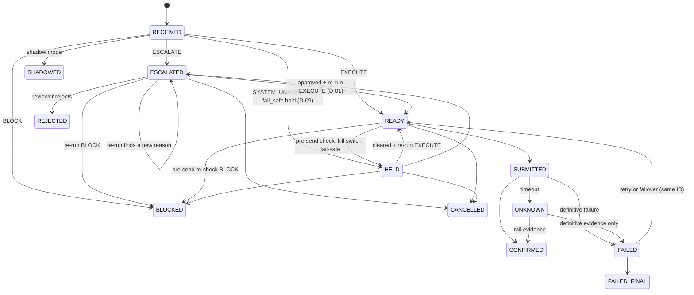
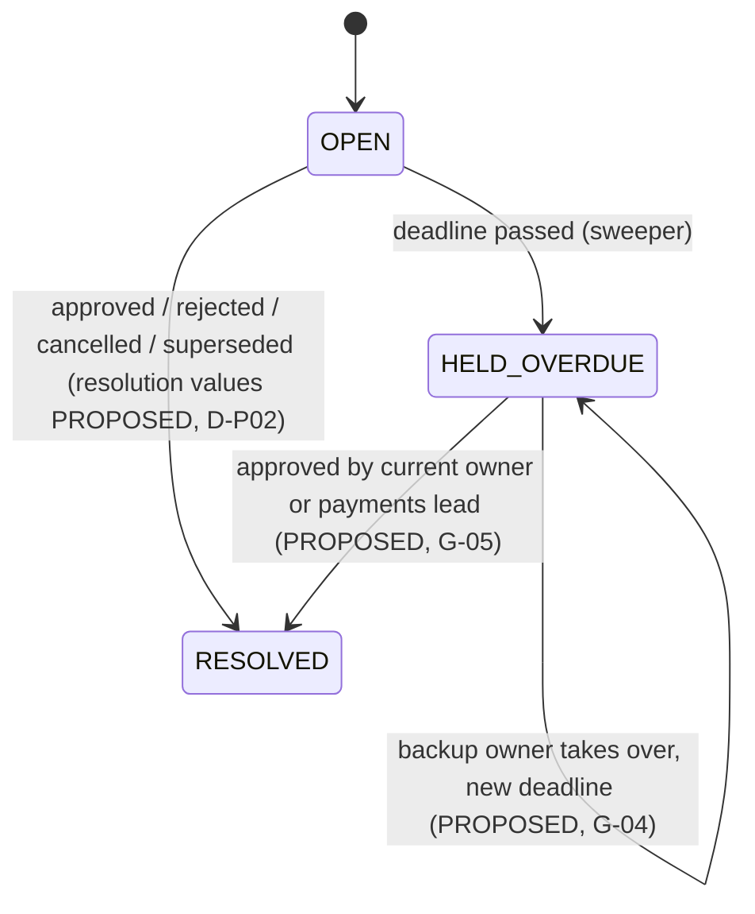

# Data model: Dekernai MVP

Phase 1 of [plan.md](plan.md). The schema's source of truth is the SQL migration
[`0001_baseline.sql`](../../apps/api/migrations/versions/0001_baseline.sql) (built and tested in M0). This page
explains it, gives every state machine, and lists the changes later slices need. Items marked **(P)** depend on a
proposed decision in [decisions.md](decisions.md).

## Conventions (confirmed, spec/02, enforced in M0)

| Rule | Enforcement |
|---|---|
| Every table has `org_id NOT NULL`; children reference `(org_id, id)` of their parent | Migration; `test_every_table_has_org_id_not_null`, `test_cross_org_reference_rejected` |
| Every SELECT, UPDATE or DELETE on an organisation table filters `org_id` | Engine guard; `test_engine_guard_blocks_unscoped_query` |
| IDs: `<prefix>_<UUIDv7 base32>`; prefix checked by a CHECK constraint | `domain/ids.py`; `test_ids.py` |
| Money: `amount_minor BIGINT` plus `currency VARCHAR(8)` in (USDC, GBP, EUR); no float, real or numeric columns | `test_no_floating_point_columns_anywhere` |
| Time: `timestamptz`, values from the Clock | `test_no_direct_time` |
| Statuses: TEXT with a CHECK listing the domain enum | Migration |

## Entities

### Decision layer

| Entity | Key fields | Constraints and notes |
|---|---|---|
| **organisations** | id, name, mode (shadow, assist, auto), fail_safe (hold, manual_queue), kind (demo, sandbox, test), api_version, expires_at | `org_id` is generated from `id`. Sandbox expiry 60 days (spec/08). Add `travel_rule_originator` (name, account) for D-03 in S1 |
| **users** | id, org_id, email, display_name, role, password_hash | Roles: payments_lead, compliance_lead, reviewer, backup_owner, oncall, admin; add `auditor` **(P, C-14)** |
| **api_keys** | id, org_id, prefix, hash, scopes[], last_used_at, revoked_at, expires_at | `prefix LIKE 'sk_test_%'` (live keys cannot exist). Add `user_id` (key issued to a named user) **(P, G-08)** in P1 |
| **counterparties** | id, org_id, name, kyb_status (verified, pending, failed, unknown **(P, C-15)**), allowlisted, jurisdiction, payment_count, median_amount_minor, median_currency | Stats recomputed from confirmed payments (INT-04). Add `contact_email` **(P, G-02)** in S6 |
| **destinations** | id, org_id, counterparty_id, kind (evm_wallet, bank_account), network, address or iban_masked, verified, first_seen_at, last_changed_at, last_changed_by | An EVM destination must have an address. Unregistered addresses on an intent become new destinations **(P, G-01)** |
| **mandates** | id, org_id, agent_id, version, payload jsonb, signature, valid_from, expires_at, revoked_at, revoked_by | Signature: HMAC-SHA256 over canonical JSON without `signature` (spec/05) |
| **mandate_usage** | org_id, mandate_id, total_minor, count | Updated atomically in the decision transaction |
| **policy_versions** | id, org_id, version, content_hash, yaml, status (draft, active, superseded), proposed_by, approved_by[], loosening, attestation, activated_at | One active per organisation (partial unique index); active and superseded rows are frozen by trigger |
| **counters** | org_id, scope, period, currency, amount_minor, count | Scope `platform:USDC`, `counterparty:<id>:USDC`, `mandate:<id>`; period UTC day **(P, G-14)** or `all` |
| **payment_intents** | id (the payment ID for life), org_id, kind, source (platform, agent), mandate_id, counterparty_id or user_account_ref, destination_id, amount_minor, currency, network_constraint, allow_network_switch, reference, notes, travel_rule, status, idempotency_key, request_hash, awaiting_send_click, initiated_by | `source = agent` requires `mandate_id`; exactly one of counterparty or user account; unique `(org_id, idempotency_key)`; amount > 0 |
| **decisions** | id, payment_id, outcome (EXECUTE, ESCALATE, BLOCK), policy_version_id, policy_hash, inputs_snapshot, checks, route, approved_reasons[], decided_at, actor | One row per evaluation; re-runs add rows; `approved_reasons` implements D-01 |
| **idempotency_records** | org_id, key, request_hash, response | All create endpoints |

### Orchestration layer

| Entity | Key fields | Constraints and notes |
|---|---|---|
| **rails** | (org_id, id), kind (evm, banksim, simchain), network, chain_id, currency, enabled, weights, prefunded_daily_limit_minor | `chain_id` only 84532, 11155111 or 31337; EVM rails must have one |
| **attempts** | id, org_id, payment_id, attempt_no, rail_id, status, failure_class, idempotency_key, from_address, nonce, raw_tx, tx_hash, rail_reference, submitted_at, resolved_at, evidence | `one_inflight_attempt`, `one_confirmed_attempt`, `one_tx_per_nonce`; FAILED needs a failure class and never TIMEOUT; UNKNOWN → FAILED needs evidence; CONFIRMED and FAILED are final |
| **kill_switch** | org_id, engaged, engaged_by/at, released_by/at | One row per organisation |
| **nonce_allocations** (S2) | org_id, rail_id, from_address, next_nonce | New table; see research R-07 |
| **cancel_replacements** (S4) | org_id, attempt_id, nonce, raw_tx, tx_hash, approved_by | spec/02 says cancel-by-replacement transactions "live in their own table" |
| **rail_health** (L, RAL-08) | org_id, rail_id, window, success_rate, p95_ms, circuit (closed, open, half_open) | New table |

### Operations layer

| Entity | Key fields | Constraints and notes |
|---|---|---|
| **exception_cases** | id, org_id, payment_id or deposit_id, type, tier, reasons[], owner_id, backup_owner_id, deadline_at, status, resolution, resolution_reason, resolved_by, resolved_at | One open case per payment and per deposit; resolved ⇔ resolution set. Resolution values **(P, D-P02)**; tier meaning **(P, C-07)** |
| **case_events** | id, case_id, kind, actor, payload, at | Assignment, overdue, comment, takeover |
| **deposit_intents** | id, org_id, account_ref, currency, network, expected_amount_minor, deposit_address or reference, status, idempotency_key | Status values **(P, D-P03)**; tolerance setting **(P, G-11)** |
| **inbound_transfers** | id, org_id, rail_id, tx_hash, log_index, from/to address, amount_minor, token, confirmations, seen_at | Unique `(rail_id, tx_hash, log_index)` |
| **credits** | id, inbound_transfer_id, deposit_intent_id, account_ref, amount_minor, journal_id | Unique `inbound_transfer_id`: one credit per inbound transfer |
| **accounts**, **journal_entries**, **postings** | accounts: kind, ref, currency; journal_entries: kind, payment_id or deposit_id, adjustment_of, memo; postings: journal_id, account_id, direction (debit, credit), amount_minor (> 0), currency | Journal entries and postings are append-only (UPDATE, DELETE, TRUNCATE raise); balance check per journal in LED-01 |
| **recon_runs**, **recon_breaks** | stats; subject, proposed_fix, rationale, status, approved_by | Break status values **(P, D-P04)** |
| **agent_calls** | id, kind, subject_id, model, prompt_version, input_hash, raw_output, parsed, tokens, latency_ms | Replay reads these; never calls a model |
| **audit_events**, **audit_heads** | seq, at, actor, actor_role, kind, subject_id, payload, prev_hash, hash | Hash chain per organisation; append-only; payloads JSON-native without floats |
| **outbox** | channel (email_mock, webhook), recipient, template, body, sent_at | Nothing sends real email |
| **jobs** | kind, dedupe_key, payment_id, payload, run_at, attempts, max_attempts, locked_by, locked_until, done_at, dead_at | Unique `(org_id, kind, dedupe_key)` |
| **incidents** | severity 1 to 4, trigger, opened_at, notified_at, root_cause | Sev 1 notification within 1 hour |

### Portal

| Entity | Key fields | Notes |
|---|---|---|
| **webhook_endpoints**, **webhook_events**, **webhook_deliveries** | url, event_types[], secret_hash; type, sequence, payload; attempt, status_code, error | Secret shown once; stored encrypted, not hashed (D-12); retry schedule **(P, G-20)** |
| **request_logs** | key_id, method, path, status, latency_ms, idempotency_key, payment_id, request_id, at | 30 days; bodies redacted |
| **invites**, **leads** | email, token_hash, expires_at, used_at; email, company, message | Invite single use, 7 days; leads in operator organisation `org_detent` **(P, D-P05)** |
| **demo_clock** | org_id, offset_seconds | Demo mode only |

## State machines

### Payment (confirmed, spec/02; one proposed edge)

Terminal: CONFIRMED, BLOCKED, REJECTED, CANCELLED, FAILED_FINAL, SHADOWED (trigger-enforced, M0). The table is code:
`detent/domain/states.py` `ALLOWED`, including the RECEIVED → HELD edge (D-09, tested).

### Attempt (confirmed, spec/02)

`CREATED → SUBMITTED → {CONFIRMED | UNKNOWN | FAILED}`; `UNKNOWN → {CONFIRMED | FAILED (evidence required)}`.
CONFIRMED and FAILED are final; a retry or failover is a new attempt row with `attempt_no + 1`.

### Exception case (confirmed statuses, EXC-01; proposed details)

No transition from any case state to an approval happens without a human action (invariant 7).

### Deposit intent (proposed, D-P03)

`OPEN → RECEIVED (inbound seen) → CREDITED (after confirmations and checks)`; `RECEIVED → EXCEPTION` on any
mismatch or flagged sender; `OPEN → EXPIRED` after the instruction's validity (validity **(P, G-21)**).

### Rule version (confirmed, spec/04)

`draft → active → superseded`. Drafts are editable and deletable; active and superseded versions are frozen by
trigger; at most one active per organisation.

### Mandate (confirmed fields, spec/05; derived state)

Derived, not stored: `not_yet_valid` (before `valid_from`), `valid`, `expired` (after `expires_at`), `revoked`
(`revoked_at` set). Usage beyond scope blocks with the specific reason.

### Reconciliation break (proposed, D-P04)

`OPEN → APPROVED → APPLIED` (adjustment entry written) or `OPEN → REJECTED`.

### Organisation (confirmed, spec/08) and API key (confirmed, spec/08)

- Organisation: `active → expired` at `expires_at` (dashboard read-only; API 403 `organisation_expired`);
  `expired → active` when the admin extends.
- Key: `active → rolled` (overlap window, then `revoked`) or `active → revoked`; `active → expired` at `expires_at`.

### Webhook delivery (schedule G-20, Confirmed D-38)

`pending → succeeded` (2xx) or `pending → retrying` (at 1 m, 5 m, 30 m, 2 h, 6 h, 24 h) `→ failed`; manual resend
creates a new delivery.

### Job (implemented, M0)

`due → claimed (lease) → done`, or `claimed → due` (failure with backoff) `→ dead` after `max_attempts`; a lost lease
rolls back the run's effects.

## Changes later slices need (forward migrations)

| Slice | Change | Reason |
|---|---|---|
| S1 | Organisation travel-rule originator fields | D-03 |
| S1 | Counterparty and destination seed from fixtures | INT-04 |
| S2 | `nonce_allocations` | R-07 |
| S3 | `exception_cases.version` (or row lock plus status check) | EXC-05 double approval |
| S4 | `cancel_replacements` | spec/02 |
| S6 | `counterparties.contact_email` if G-02 is approved; two-person mode change table | G-02, EXE-09 |
| P1 | `webhook_endpoints.secret_encrypted` replaces `secret_hash` (D-12); `api_keys.user_id` if G-08 is approved; `users.role` adds `auditor` (C-14, Confirmed D-38) | G-08, C-14 |
| P2 | `organisations.data_generation` and a `generation` column on intents, cases, ledger and logs; queries filter the current one | D-08 |
